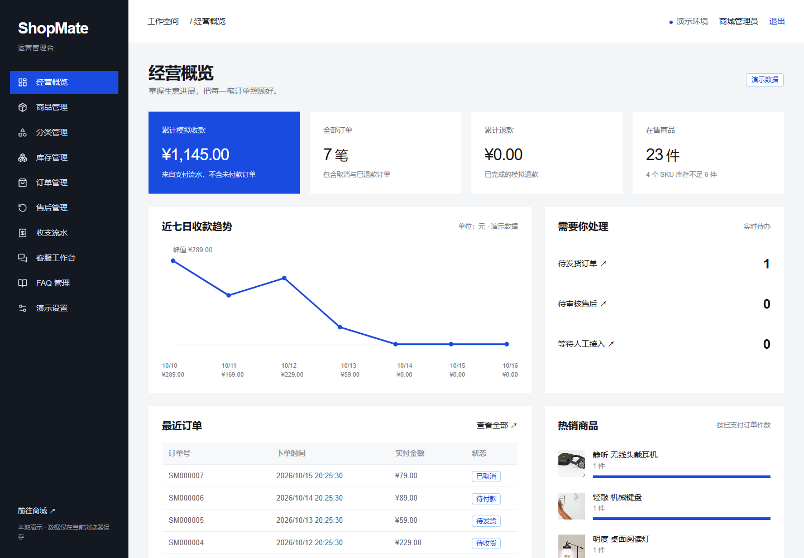

# ShopMate-AI

中文综合百货商城与电商客服业务体验项目。用户端完成选购、模拟支付、订单与售后；管理端集中管理商品、库存、订单、收支和人工客服。采用 Vue 3、TypeScript、Vite、Vue Router、Pinia，管理端使用 Element Plus。

**登录与注册已接入真实服务端认证，账号和业务数据保存在 SQLite。支付、物流、退款和客服回复仍为模拟，未接入真实支付渠道或大模型。** 商品、规格、图片与价格只用于体验交互，不能据此进行真实交易。




## 快速访问

在已安装并运行 Docker Desktop 的机器上，从仓库根目录执行。首次启动先配置管理员密码：

```powershell
if (-not (Test-Path .env)) { Copy-Item .env.example .env }
# 编辑 .env，填写 ADMIN_PASSWORD：10–128 位，至少包含字母和数字。
# 如已有 .env，请直接编辑，保留已有配置。
docker compose up -d --build --wait
```

- 商城：<http://localhost:18086/>
- 用户登录：<http://localhost:18086/login>
- 用户注册：<http://localhost:18086/register>
- 管理端：<http://localhost:18086/admin/>
- 静态站点健康检查：<http://localhost:18086/healthz>
- 后端与数据库健康检查：<http://localhost:18086/api/health>

默认只监听 `127.0.0.1:18086`，后端没有主机映射端口。修改端口时同步更新 `.env` 的 `APP_PORT` 与 `APP_ORIGINS`。`localhost` 与 `127.0.0.1` 的 Cookie 独立，请统一使用一种地址。部署到 HTTPS 时设置 `COOKIE_SECURE=true` 并配置实际访问源。

```powershell
docker compose ps
docker compose logs --tail 100 web
docker compose stop
docker compose up -d --wait
```

Compose 项目名为 `shopmate-ai`，包含 Nginx `web` 与 Node.js `api` 两个服务。Nginx 将 `/api/` 转发到后端。SQLite 文件位于后端 `/app/data/shopmate.sqlite`，持久化到 `shopmate-ai_api_data` 命名卷；容器重启、重建保留数据。不要使用 `docker compose down -v`，它会删除该项目数据卷。

### 账号与登录

- 用户在 `/register` 注册：账号以字母开头，支持字母、数字和下划线，3–32 位；昵称最多 30 字；密码 10–128 位，须含字母与数字。账号不区分大小写，重复注册会被拒绝。注册成功后自动登录，并保留合法的商城回跳路径。
- 管理员首次启动从 `.env` 的 `ADMIN_USERNAME`（默认 `admin`）和 `ADMIN_PASSWORD` 初始化，不开放公开注册。项目没有预设通用密码。已有管理员不会在重启时被环境变量覆盖。
- 用户与管理员使用独立 Cookie，可在同一浏览器同时登录；同一角色在标签页之间共享登录状态。退出会撤销服务端会话，最长有效期 8 小时。刷新、跨浏览器登录和容器重建均由服务端数据验证。
- 原来的 `lin`、`chen` 和 `demo123` 不再是可用的内置账号。旧浏览器中的演示数据库、账号和会话不会导入或作为认证依据；真实账号、订单从新的服务端数据库开始。测试目录的固定账号只用于隔离测试，不会初始化到日常服务。

更换管理员密码：编辑 `.env` 中的 `ADMIN_PASSWORD` 后，执行以下命令更新数据库并撤销所有旧管理员会话。只编辑配置或重建容器不会自动改密。

```powershell
docker compose run --rm --no-deps api npm run admin:password
```

`.env` 包含本机凭据，已加入 Git 忽略；勿上传。用户可在个人中心修改昵称及登录密码；改密校验原密码并撤销该用户全部会话，须重新登录，不影响管理员会话。当前未实现邮箱/短信验证、找回密码或多因素认证。

## 页面与功能

| 用户端 | 路径 | 主要操作 |
| --- | --- | --- |
| 登录、注册 | `/login`、`/register` | 服务端验证、注册自动登录、错误提示、登录回跳 |
| 首页、分类 | `/`、`/categories` | 首页即时切换分类、在售数量、分类目录、本地规则推荐 |
| 搜索与列表 | `/products` | 多关键词、分类、价格、有货筛选、排序、分页与条件移除，状态保存在 URL |
| 商品详情 | `/products/:id` | 图片、SKU、库存、加购、立即购买、收藏、公开购买评价 |
| 购物车、结算 | `/cart`、`/checkout` | 批量勾选/删除、清理失效项、结算内维护地址、服务端报价、用券、幂等下单 |
| 订单与模拟支付 | `/orders`、`/orders/:id`、`/orders/:id/pay` | 搜索分页、付款倒计时、超时关闭、进度、再次购买、确认收货、按数量售后 |
| 个人中心 | `/account` | 资料/改密、收藏与地址、我的优惠券、待评价/我的评价、切换账号 |
| 领券中心 | `/coupons` | 全店满减券领取、有效期、每人限领和发行限额 |
| 售后、客服 | `/after-sales`、`/support` | 部分退款、撤销申请、模拟退货单号和进度；客服保持原规则功能 |
| 素材说明 | `/credits` | 作者、原始来源、许可、演示边界 |

| 管理端 | 路径 | 主要操作 |
| --- | --- | --- |
| 登录与概览 | `/admin/login`、`/admin` | 经营汇总、趋势、热销、低库存与待办 |
| 商品与分类 | `/admin/products`、`/admin/categories` | 创建、编辑、SKU、图片上传预览、上下架、分类排序 |
| 优惠券与评价 | `/admin/coupons`、`/admin/reviews` | 满减券创建与启停、领取后锁定配置、评价隐藏与恢复 |
| 库存 | `/admin/inventory` | 补货与盘点调整、采购支出、变动记录 |
| 订单与售后 | `/admin/orders`、`/admin/after-sales` | 发货、物流信息、审核、退货收货、模拟退款 |
| 财务 | `/admin/finance` | 收款、退款、采购支出、日期筛选、CSV 导出 |
| 客服与 FAQ | `/admin/support`、`/admin/knowledge` | 转人工接待、回复、关闭会话、规则问答启停 |
| 设置 | `/admin/settings` | 商城名称、标语、公告与恢复演示数据 |

初始化 24 件演示商品、48 个 SKU、6 个分类，包含下架、缺货与低库存商品。日常服务不再初始化演示用户、订单或地址；新注册用户拥有空的购物车、收藏、订单和地址。所有统计从当前演示数据计算，没有独立写死的营收指标。管理端桌面优先，小屏折叠菜单，宽表在自身区域滚动。

### 分类与搜索

- 首页分类按后台配置排序，显示各类在售商品数；点击立即切换商品目录，再通过「查看该分类」进入列表。手机分类栏可左右滑动。分类页与列表使用相同的排序和计数，下架商品不参与展示，售罄商品默认保留提示。
- 搜索覆盖商品名称、副标题、说明、材质、分类名和 SKU 规格；多个词以空格、中文逗号或顿号分隔，须全部匹配。例如 `通勤 耳机`、`数码 茶轴`。大小写、全角英数字统一匹配；首页规则推荐使用相同的匹配规则，最多展示 4 件。
- 可组合分类、最低/最高价格、仅看有货及推荐/价格排序。价格范围包含边界，支持两位小数，按卡片显示的最低 SKU 价格筛选；「仅看有货」表示至少一个规格有库存，最终可购买数量仍以商品详情及服务端校验为准。
- 搜索与价格分别提交，未应用的输入不会随另一表单提交；已选条件可逐个移除或全部清除。每页 12 件，改变筛选/排序回到第一页；刷新、分享链接和浏览器前进后退保留已应用条件。
- 非法数字与未知排序回退默认行为；越界页码显示最后一页，已失效分类及倒置价格范围显示可恢复的空状态。

示例：<http://localhost:18086/products?category=c1&min=169&max=289&stock=1&sort=price-asc>。当前目录由浏览器对服务端公开商品数据做规则筛选，未接入全文搜索服务或语义搜索。验证范围及容器只读验收命令见 [分类与搜索验证](docs/catalogue.md)。

## 体验完整闭环

1. 注册用户，进入个人中心添加收货地址；选择商品和规格，加购物车、结算并确认模拟支付。
2. 在同源的另一个标签页使用配置的管理员账号登录，查看订单与收款流水，填写演示物流并发货。
3. 回到用户端，订单状态同步更新，可确认收货或申请售后。
4. 从订单选择本次申请的商品及数量。未发货售后批准后可退款；已发货/已完成订单须先审核、由用户填写模拟退货承运商与单号，再由管理端确认收到退货并退款。退款仅回补本次数量并记录本次实退金额。
5. 从商品页或订单详情进入客服。先体验本地 FAQ，再点击转人工，在后台客服工作台回复，用户会话会同步显示。
6. 在库存管理补货并填写采购金额，检查库存变动与采购支出；在财务页筛选和导出 CSV。

模拟规则：金额使用整数分；结算由服务端生成 5 分钟有效报价，创建订单保留商品、单价、地址和优惠快照。提交订单不占库存，付款时再次检查商品状态与库存；30 分钟未支付自动关闭。重复下单、付款和退款不会重复创建订单、扣库、回补或记账。服务端通过 SQLite `BEGIN IMMEDIATE` 事务串行提交业务变动，异常时回滚；首次库存和每次变动都有记录。

财务净收支为收款减退款、减录入的采购支出，**不代表利润**，没有税费、运费、手续费、成本结转或真实结算。售后支持按订单行及数量分批申请与部分退款，不包含真实退货寄件、换货或支付渠道退款。

客服仅基于商品、当前账号订单和启用的 FAQ 做服务端规则匹配。未知问题提示转人工；客服不能直接付款、改库存或批准退款，也没有外部知识检索、真实大模型或远程人工坐席服务。

## 传统电商规则

- **结算：** 立即购买独立结算，不改变购物车；购物车结算只消费本次报价条目。地址、商品价格、规格或条目发生变化时必须重新获取并确认报价，不能用客户端金额覆盖服务端金额。同一请求标识的下单结果保留 24 小时，同一报价也只能生成一个订单。
- **库存和时限：** 下单不预占库存。订单保留 30 分钟付款窗口，服务启动及每分钟关闭超时订单，付款入口再次检查截止时间；过期订单无法付款。报价及付款时都检查可售与库存。
- **满减券：** 后台配置全店固定金额满减、领取/使用时间及发行量，每人每券限领一次，每单最多一张且不可叠加。减免额小于门槛，应付至少 1 分。下单占券、付款核销、取消/超时释放；释放后仍按原有效期判断。已创建订单保留优惠至付款截止，已领取券的规则禁止修改，只能启停；日常数据库不会自动注入样例券。
- **优惠分摊：** 按订单行原金额使用最大余数法分摊优惠；部分退款按累计已退数量计算实付金额，最后一笔吸收分币尾差。退款不重算满减门槛、不退券，累计退款和库存回补不能超过实付和购买数量。
- **售后：** 同一订单同时只允许一笔进行中申请，结束后可继续申请剩余数量。提交退货单号前可撤销；发货后必须填写模拟退货信息，管理员收货后才能退款。部分退款保留履约状态，全部退款后订单变为已退款；有进行中售后时禁止发货或确认收货。
- **评价：** 已收货、尚有未退款数量且无进行中售后的订单行可评价一次，1–5 星、5–1000 字纯文本，无图片或追评。发布即展示，昵称脱敏；用户可删除，后台可隐藏/恢复。删除后不能重评，整行退完后评价不再公开或计入评分，历史记录仍保留。

个人中心可以直接移除下架收藏；购物车全选只选择可结算项，清理失效商品保留单纯缺货项；再次购买按当前库存和价格加购，并列明无法加入的商品，不自动下单。订单搜索支持订单号/商品名，状态及每页 10 条分页保存在 URL。

新增能力、v1→v2 数据迁移、接口与测试范围见 [传统电商验证](docs/traditional-commerce.md)。AI 客服、Agent 和模型接入另行实施，当前客服规则保持不变。

双端运营补全按功能独立测试、提交并等待 CI 后继续，进度见 [逐功能交付记录](docs/incremental-delivery.md)。设置编辑保留未保存草稿，并在保存时检查编辑基线；远端修改发生冲突时需加载最新设置再编辑，公告支持清空。

操作已确认成功但状态同步失败时，页面保留成功结果并提示重新连接；连接恢复不自动重复提交。写入响应丢失或不可解析时显示“结果暂无法确认”，须先核对最新记录。同角色的已验证数据可暂时只读显示，首次读取或角色切换失败时隐藏业务内容，避免混用身份或把连接故障当成未登录。

## 本地开发与验证

建议 Node.js 24，与 Docker 和 CI 保持一致。具体依赖版本由前后端各自的 `package-lock.json` 锁定。

配置根目录 `.env` 后，分别在两个终端启动后端和前端：

```powershell
cd backend
npm ci
npm run dev
```

```powershell
cd frontend
npm ci
npm run dev
```

后端默认 `127.0.0.1:3001`，Vite 默认 `127.0.0.1:5173` 并代理 `/api/`。本地开发数据保存在 `backend/data/shopmate.sqlite`，与 Docker 数据卷独立；后端启动脚本自动读取根目录 `.env`。开发时在 `APP_ORIGINS` 中加入实际的 Vite 访问源，如 `http://127.0.0.1:5173`。

```powershell
npm --prefix backend run typecheck
npm --prefix backend test
npm --prefix backend audit --omit=dev --audit-level=high --registry=https://registry.npmjs.org
npm --prefix frontend run typecheck
npm --prefix frontend run lint
npm --prefix frontend test
npm --prefix frontend audit --omit=dev --audit-level=high --registry=https://registry.npmjs.org
npm --prefix frontend run build
npm --prefix frontend run test:e2e
```

Windows 浏览器测试默认使用已安装的 Microsoft Edge；Linux CI 使用 Playwright Chromium，需要先执行 `npx playwright install --with-deps chromium`。浏览器测试会自动启动隔离后端与 Vite。固定测试账号和业务种子只写入 `backend/.e2e/shopmate.sqlite`，每项测试前重置，不使用日常数据库。测试前请释放本机 3001 与 5173 端口。

对单独的验收部署运行真实账号认证测试（会注册测试用户并创建一笔模拟订单，请使用隔离部署）：

```powershell
$env:PLAYWRIGHT_BASE_URL = 'http://127.0.0.1:18087'
$env:E2E_ADMIN_PASSWORD = '填写验收部署的管理员密码'
npm --prefix frontend run test:e2e -- e2e/auth.spec.ts
Remove-Item Env:PLAYWRIGHT_BASE_URL
Remove-Item Env:E2E_ADMIN_PASSWORD
```

外部地址模式不会写入测试种子或重置服务端数据；依赖种子的旧业务用例应通过默认的隔离本地模式运行。截图脚本需提供 `ADMIN_PASSWORD`；全页审查脚本还需提供已注册的 `USER_USERNAME` 和 `USER_PASSWORD`。

GitHub Actions 执行前后端安装、类型检查、ESLint、单元/HTTP 测试、依赖审计、构建、完整浏览器回归及 Docker 认证、公开目录、传统交易闭环验收。认证设计、接口与当前验证结果见 [认证与部署验证](docs/authentication.md)。[首版交付验证](docs/verification.md) 和 [全站界面复审](docs/ui-review.md) 记录的是此前前端演示阶段。

## 数据保存与项目结构

服务端 SQLite 保存账号、密码哈希、会话摘要与业务数据。首次升级自动将业务状态迁移到 v2，保留账号、会话、历史订单/库存/流水，旧待付款订单只获得一次 30 分钟窗口；部署前须备份数据库。当前使用独立账号/会话表和一份事务化业务 JSON 状态，适合单实例体验与功能验证；后续高并发业务应拆分业务表和索引。前端只缓存服务端按身份过滤的数据，不保存密码、会话令牌或完整数据库；页面每 2 秒同步一次，隐藏标签页暂停轮询。

管理端「演示设置 → 恢复演示数据」会重置**全体用户的业务数据**并恢复初始商品，保留已注册账号、密码与会话。此操作有明确确认提示；不等于删库或重置账号。备份 SQLite 应使用 SQLite 备份机制或停服后复制完整数据卷，不能只复制运行中的主文件而忽略 WAL。

```text
backend/src/auth.ts        密码哈希、会话、限流和账号创建
backend/src/app.ts         HTTP 接口、来源检查、权限与按身份过滤
backend/src/database.ts    SQLite 初始化和事务
backend/src/               服务端商品、交易、库存、售后与客服规则
backend/test/              HTTP 认证与业务规则测试
shared/domain/             前后端共享类型、API 契约与商品种子
frontend/src/domain/       共享类型入口与素材清单
frontend/src/services/     HTTP 客户端、服务端状态缓存
frontend/src/stores/       Pinia 状态与角色会话展示
frontend/src/views/shop/   商城页面
frontend/src/views/admin/  懒加载管理页面
frontend/e2e/              浏览器回归与隔离数据库夹具
frontend/public/images/    本地图片与来源校验清单
deploy/                   Nginx 配置
docs/                     认证验证、设计、素材与截图
```

所有业务修改均经过服务端：接口按方法固定所需角色，从有效 Cookie 解析身份；订单、地址、购物车与会话操作再检查数据归属。公开注册不能指定角色，客户端提供的用户 ID、角色或存储内容不能授予权限。管理数据只返回给已认证管理员，用户只能读取自己的私有数据。

## 设计与素材

依据指定的 design-taste-frontend skill，采用 **The contact sheet / seed `20261016`**。白色、黑色、浅灰与单一蓝色强调，商品目录作为首页主体，购物咨询连接商品和订单。品牌标题字体本地打包，正文统一使用系统无衬线字体；支持减少动态效果。

已统一全站字号与间距：商城标题32/24px、管理端28/24px（桌面/手机），收紧详情、订单、客服和页脚的空白，优化手机管理弹窗与日期筛选。检查范围、截图重建命令及取舍见 [全站界面复审](docs/ui-review.md)。

24 张真实摄影保存在项目内，不运行时请求第三方图片。完整作者、许可、源页和处理方式见 [素材清单](docs/assets.md) 与站内 `/credits`。图片仅为品类演示，部分有原始品牌标识，不代表真实商品、品牌授权或合作关系。图片各自保留原许可，CC BY-SA 素材的改编继续按相应许可提供；字体使用 SIL Open Font License。仓库尚未为原创业务代码指定开源许可证。

后续真实业务接入仍需完善账号恢复与风控、业务分表、备份运维，再接入真实支付/物流；模型服务代理、Agent 和知识库另行规划，模型密钥不能放入前端。多商家、会员积分、发票、换货、真实财务和生产部署不在本期范围。
