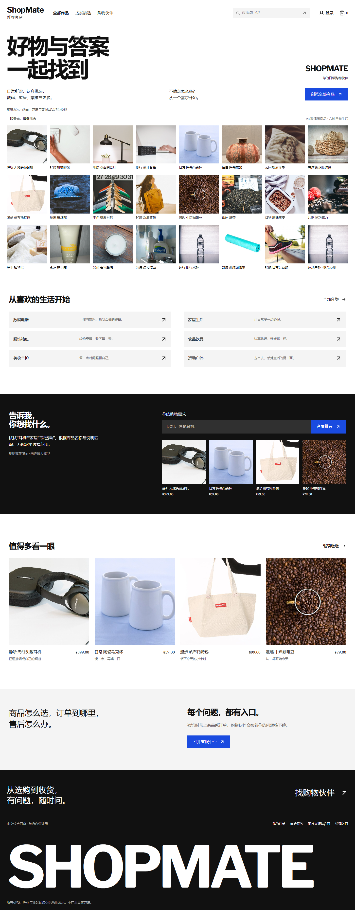

# ShopMate-AI

中文综合百货商城与电商客服前端演示。用户端完成选购、模拟支付、订单与售后；管理端集中管理商品、库存、订单、收支和人工客服。采用 Vue 3、TypeScript、Vite、Vue Router、Pinia，管理端使用 Element Plus。

**当前版本是纯前端演示。登录、支付、物流、退款、客服回复均为模拟；没有真实模型、业务服务器或数据库。** 商品、规格、图片、价格和经营数据只用于体验交互，不能据此进行真实交易。




## 快速访问

在已安装并运行 Docker Desktop 的机器上，从仓库根目录执行：

```powershell
docker compose up -d --build --wait
```

- 商城：<http://localhost:18086/>
- 用户登录：<http://localhost:18086/login>
- 管理端：<http://localhost:18086/admin/>
- 容器健康检查：<http://localhost:18086/healthz>

默认只监听 `127.0.0.1:18086`，不向局域网开放。端口冲突时复制 `.env.example` 为 `.env`，修改 `APP_PORT` 后重新启动。`localhost` 与 `127.0.0.1` 是不同浏览器源，请为商城和后台统一使用同一种地址，才能共享演示数据。

```powershell
docker compose ps
docker compose logs --tail 100 web
docker compose stop
docker compose up -d --wait
```

Compose 项目名为 `shopmate-ai`，仅包含一个 Nginx 静态站点容器，不创建数据库或数据卷。镜像使用 Node 构建，再复制产物到 Nginx；详情页和管理页支持直接打开与刷新。

### 演示账号

| 角色 | 账号 | 密码 |
| --- | --- | --- |
| 用户 · 林小满 | `lin` | `demo123` |
| 用户 · 陈一禾 | `chen` | `demo123` |
| 管理员 | `admin` | `demo123` |

登录页有填入账号按钮。用户和管理员会话独立，可以在同一浏览器的两个标签页分别登录。本期不包含注册、短信验证码或密码找回；不要输入真实密码和个人信息。

## 页面与功能

| 用户端 | 路径 | 主要操作 |
| --- | --- | --- |
| 首页、分类 | `/`、`/categories` | 商品目录、六类商品、本地规则推荐 |
| 搜索与列表 | `/products` | 关键词、分类、价格、排序、分页，筛选条件写入 URL |
| 商品详情 | `/products/:id` | 图片、SKU、库存、加购、收藏、带商品上下文咨询 |
| 购物车、结算 | `/cart`、`/checkout` | 勾选、改数量、删除、选地址、创建订单 |
| 订单与模拟支付 | `/orders`、`/orders/:id`、`/orders/:id/pay` | 付款、取消、查看物流、确认收货、申请售后 |
| 个人中心 | `/account` | 收藏与收货地址维护、切换账号 |
| 售后、客服 | `/after-sales`、`/support` | 售后进度、FAQ、商品推荐、订单查询、转人工 |
| 素材说明 | `/credits` | 作者、原始来源、许可、演示边界 |

| 管理端 | 路径 | 主要操作 |
| --- | --- | --- |
| 登录与概览 | `/admin/login`、`/admin` | 经营汇总、趋势、热销、低库存与待办 |
| 商品与分类 | `/admin/products`、`/admin/categories` | 创建、编辑、SKU、图片上传预览、上下架、分类排序 |
| 库存 | `/admin/inventory` | 补货与盘点调整、采购支出、变动记录 |
| 订单与售后 | `/admin/orders`、`/admin/after-sales` | 发货、物流信息、审核、退货收货、模拟退款 |
| 财务 | `/admin/finance` | 收款、退款、采购支出、日期筛选、CSV 导出 |
| 客服与 FAQ | `/admin/support`、`/admin/knowledge` | 转人工接待、回复、关闭会话、规则问答启停 |
| 设置 | `/admin/settings` | 商城名称、标语、公告与恢复演示数据 |

初始化 24 件演示商品、48 个 SKU、6 个分类，包含下架、缺货、低库存、不同状态的订单及两个用户的地址。所有统计从当前演示数据计算，没有独立写死的营收指标。管理端桌面优先，小屏折叠菜单，宽表在自身区域滚动。

## 体验完整闭环

1. 使用 `lin` 登录，选择商品和规格，加购物车、结算并确认模拟支付。
2. 在同源的另一个标签页登录 `admin`，查看订单与收款流水，填写演示物流并发货。
3. 回到用户端，订单状态同步更新，可确认收货或申请售后。
4. 未发货售后批准后可退款；已发货/已完成订单必须先审核、再确认收到退货，之后才能模拟退款。退款同步回补库存并记流水。
5. 从商品页或订单详情进入客服。先体验本地 FAQ，再点击转人工，在后台客服工作台回复，用户会话会同步显示。
6. 在库存管理补货并填写采购金额，检查库存变动与采购支出；在财务页筛选和导出 CSV。

模拟规则：金额使用整数分；订单保存商品、单价和地址快照；提交订单不占用库存，付款时再次检查商品状态与库存。重复付款与退款不会重复扣库、回补或记账。同源支持 Web Locks 的浏览器通过锁串行提交变动；不支持时仅保证同标签页串行。首次库存和每次变动都有记录。

财务净收支为收款减退款、减录入的采购支出，**不代表利润**，没有税费、运费、手续费、成本结转或真实结算。售后仅支持整单申请与整单退款，不包含部分退款、真实退货寄件或支付渠道退款。

客服仅基于商品、当前账号订单和启用的 FAQ 做本地规则匹配。未知问题提示转人工；客服不能直接付款、改库存或批准退款，也没有外部知识检索、真实大模型或远程人工坐席服务。

## 本地开发与验证

建议 Node.js 24，与 Docker 和 CI 保持一致。具体依赖版本由 `frontend/package-lock.json` 锁定。

```powershell
cd frontend
npm ci
npm run dev
```

```powershell
npm run typecheck
npm run lint
npm test
npm run build
npm run test:e2e
```

Windows 浏览器测试默认使用已安装的 Microsoft Edge；Linux CI 使用 Playwright Chromium，需要先执行 `npx playwright install --with-deps chromium`。浏览器测试会自动启动 Vite 开发服务器。

从 Docker 地址运行同一套浏览器验证：

```powershell
$env:PLAYWRIGHT_BASE_URL = 'http://127.0.0.1:18086'
npm run test:e2e
node scripts/capture.mjs
Remove-Item Env:PLAYWRIGHT_BASE_URL
```

测试使用隔离浏览器上下文，不修改日常浏览器数据。GitHub Actions 执行安装、类型检查、ESLint、Vitest、构建和 Playwright；失败保留浏览器证据。验收结果及设计复审见 [交付验证](docs/verification.md) 和 [设计说明](docs/design.md)。

## 数据保存与项目结构

业务数据保存在 `localStorage` 的 `shopmate-ai:database:v1`，角色会话保存在 `sessionStorage`；刷新可恢复业务数据，同源标签页通过存储事件联动。关闭会话、清浏览器存储、换地址/端口、换浏览器或设备，会影响对应的会话或数据可见性。容器重启不会删除浏览器数据，容器也不备份这些数据。

恢复入口：管理端 → 演示设置 → 恢复演示数据，输入 `恢复演示` 确认。损坏或不兼容的数据会提示并仅显示初始预览，不悄悄覆盖原始内容；恢复前如需保留数据，请自行备份浏览器存储。

```text
frontend/src/domain/        业务类型、种子数据、素材清单
frontend/src/services/      异步模拟服务、存储校验与原子提交
frontend/src/stores/        Pinia 数据订阅和角色会话
frontend/src/views/shop/    商城页面
frontend/src/views/admin/   懒加载管理页面
frontend/e2e/              用户端、管理端和跨端浏览器测试
frontend/public/images/    本地图片与来源校验清单
deploy/                    Nginx 配置
docs/                      设计、素材、验收与截图
```

组件通过异步服务接口修改业务数据，不直接写浏览器存储。后续可在这一边界接入 HTTP 服务。但当前前端持有完整演示数据库，任何人都可通过开发者工具查看或修改；路由守卫与用户筛选仅演示产品行为，不能代替服务端身份认证、租户隔离和权限校验。

## 设计与素材

依据指定的 design-taste-frontend skill，采用 **The contact sheet / seed `20261016`**。白色、黑色、浅灰与单一蓝色强调，商品目录作为首页主体，购物咨询连接商品和订单。字体本地打包，中文使用系统字体；支持减少动态效果。

24 张真实摄影保存在项目内，不运行时请求第三方图片。完整作者、许可、源页和处理方式见 [素材清单](docs/assets.md) 与站内 `/credits`。图片仅为品类演示，部分有原始品牌标识，不代表真实商品、品牌授权或合作关系。图片各自保留原许可，CC BY-SA 素材的改编继续按相应许可提供；字体使用 SIL Open Font License。仓库尚未为原创业务代码指定开源许可证。

后续真实业务接入应依次增加服务端认证与权限、数据库和订单库存事务，再接入支付/物流、模型服务代理与知识库；模型密钥不能放入前端。多商家、优惠券、评价、真实财务和生产部署不在本期范围。
