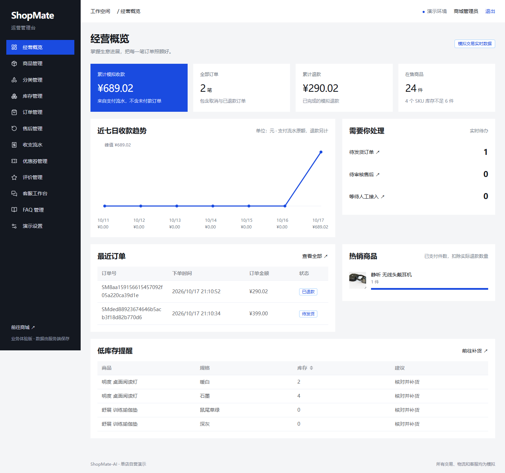
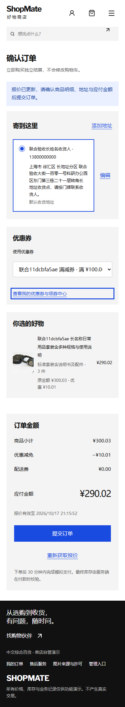
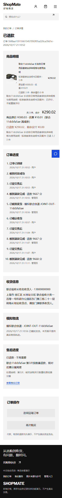

# ShopMate-AI

一个包含用户商城和运营后台的中文单店、单仓电商项目，覆盖商品选购、库存预占、订单履约、营销积分、采购入库、退货质检及员工权限，并可接入有来源引用和操作确认的 AI 客服。

**账号认证和数据持久化已实现；支付、物流、退款均为模拟。AI 客服需要配置模型 API，默认关闭；未开启时使用 FAQ 规则和人工回复。**

## 解决什么问题

- 将用户购买与后台发货、售后、库存、财务串成完整业务闭环，双端共享服务端数据。
- 由服务端统一校验身份、价格、优惠、库存和退款，处理重复提交与异常恢复。
- 将 AI 问答与商品、本人订单和已发布知识连接；加购、取消待付款订单和申请售后由用户确认后提交。

## 主要功能

| 模块 | 功能 |
| --- | --- |
| 用户商城 | 注册登录、分类搜索、商品规格、收藏、购物车、省份地址、优惠券、满减择优、运费报价、下单与模拟支付 |
| 订单与售后 | 30 分钟库存预占、超时关闭、再次购买、收货评价、分批退款、运费退款规则、模拟退货与进度查询 |
| 会员与消息 | 收货积分、退款冲回、积分明细、站内通知与已读状态；积分不抵现 |
| 运营后台 | 商品分类、上下架、补货盘点、订单发货、售后处理、配送规则、满减活动、优惠券与评价管理 |
| 单仓与财务 | 供应商、采购单、分批入库、退货隔离和良品质检入库、财务核对、分页查询与筛选结果 CSV 导出 |
| 员工与维护 | 店主／运营／仓储／客服／财务权限、操作审计、持久化任务、在线备份与离线恢复 |
| AI 客服与知识 | 多轮问答、商品推荐、本人订单／模拟物流／售后查询、知识引用、确认后业务操作；FAQ、文档识别与人工发布、转人工 |
| 商城设置 | 商城名称和公告设置 |

项目为单店业务演示，不包含真实支付物流或多商家功能。

## 技术栈

| 层次 | 技术与用途 |
| --- | --- |
| 前端 | Vue 3 + TypeScript + Vite；Vue Router 管理路由，Pinia 管理状态，Element Plus 构建后台界面 |
| 后端 | Node.js 24 + Express，Zod 校验接口参数；Cookie 会话认证与服务端权限校验 |
| 数据 | SQLite WAL；分领域记录表及 SKU／订单行关系表，索引分页与事务；订单等历史快照保留 JSON 字段 |
| 部署 | Docker Compose 编排 API/Web，Nginx 托管前端并代理 API |
| 验证 | Vitest 单元／HTTP 测试、Playwright 浏览器测试、GitHub Actions 自动验证 |

## 快速部署

需要 Git、已启动的 Docker，以及支持 `--wait` 的 Compose 插件（使用 `docker compose` 命令）。Windows/macOS 可使用 Docker Desktop，Linux 可使用 Docker Engine 和 Compose 插件。

Docker 部署无需在本机安装 Node.js、npm、SQLite 或 PDF 工具。默认规则客服不需要模型 API Key；启用 AI 需额外配置。首次构建需要访问镜像仓库和 npm 源；若希望直接运行源码，见 [本地开发](docs/development.md#本地开发)。

### 1. 获取项目

```sh
git clone https://github.com/W205614/ShopMate-AI.git
cd ShopMate-AI
```

在项目根目录复制配置文件，已有 `.env` 时保留原配置。Windows PowerShell：

```powershell
if (-not (Test-Path .env)) { Copy-Item .env.example .env }
```

Linux/macOS 终端使用：

```sh
[ -f .env ] || cp .env.example .env
```

### 2. 配置管理员

用编辑器打开 `.env`，填写 `ADMIN_PASSWORD`：10–128 位，至少包含字母和数字。管理员账号默认为 `admin`，可通过 `ADMIN_USERNAME` 修改。

管理员仅在首次启动时创建；已有部署请保留原 `.env`，修改环境变量不会覆盖已有管理员密码。不要提交包含凭据的 `.env`。

### 3. 启动服务

Linux 首次部署先准备备份绑定目录，避免 Docker 自动创建的 root 属主目录使 API 无法写入。容器以 UID/GID `1000:1000` 运行；新目录使用 `0700` 权限。如果自定义了 `BACKUP_PATH`，将下面的 `./backups` 换成对应目录，父目录应已存在。

```sh
if [ ! -e ./backups ]; then
  mkdir -m 0700 -- ./backups
  sudo chown 1000:1000 -- ./backups
fi
ls -ldn -- ./backups
```

已有目录应先核对用途、属主和权限，再按需调整该目录本身；不要递归修改备份文件或其他数据目录。Windows Docker Desktop 通常无需上述 Linux 权限准备，启动后仍应检查备份目录可写并验证首次备份，见 [可靠性与运维](docs/reliability.md#正常运行和观测)。

```powershell
docker compose up -d --build --wait
```

所有命令均在项目根目录执行。检查 `docker compose ps`，`api` 和 `web` 应为运行且 `healthy`；访问 <http://localhost:18086/api/health> 应返回 `{"status":"ok"}`。

浏览器入口：

- 商城：<http://localhost:18086/>
- 用户注册：<http://localhost:18086/register>
- 管理端：<http://localhost:18086/admin/login>，使用上面配置的管理员账号登录。

默认仅供本机访问，体验时统一使用 `localhost`，避免与 `127.0.0.1` 混用导致 Cookie 不共享。公网部署还需配置 HTTPS、访问源及入口，见 [开发与运维](docs/development.md)。

## 第一次体验

全新部署自带商品、分类和 FAQ，但没有普通用户、订单或优惠券；后台订单和营收为空是正常现象。管理员使用 `.env` 配置的账号，普通用户自行注册，没有通用测试账号。

1. 用户注册后，选择**有库存的商品规格**，加入购物车或立即购买，填写地址并完成模拟支付。
2. 用同一浏览器的另一个标签页登录管理端，在“订单管理”找到该订单，填写模拟承运商和单号后发货。
3. 回到用户端确认收货并评价；如需体验售后，按页面申请退款或退货退款，再由管理端审核处理。
4. 优惠券为可选流程：管理员先在“优惠券管理”创建并开放领取，再由用户到“领券中心”领取，在满足门槛时使用。

“经营工作台”可配置配送与满减，创建供应商和采购单、分批入库，处理退货质检并管理员工。原管理员自动拥有店主权限。满减和优惠券不叠加，服务端择优，同额优先满减；确认收货后商品实付每满 1 元得 1 积分。

新订单预占库存 30 分钟；历史待付款订单保留原付款扣库规则和到期时间。已发货退货进入隔离库存，退款不会自动增加可售量，须经仓储质检。网页恢复演示数据默认关闭。

## 启用 AI 客服（可选）

在根目录被忽略的 `.env` 中填写自己的 DeepSeek 官网配置，保留已有管理员、端口及备份设置：

```dotenv
AI_ENABLED=true
LLM_BASE_URL=https://api.deepseek.com
LLM_MODEL_ID=deepseek-flash
LLM_API_KEY=填写你的服务端APIKey
```

执行 `docker compose up -d --build --wait` 应用配置。用户登录后进入“客服”，也可从商品或本人订单进入咨询，查看排队／处理进度及完整回答。模型只能生成操作卡片，用户点击确认后才执行加购、取消待付款订单或申请售后；不会自动付款、发货或退款。模型不可用时保留消息，显示失败与重试／转人工入口。

需要文档知识库时，继续配置 `.env.example` 中的 Embedding 和可选 Reranker，见 [AI 配置与运行说明](docs/ai-support.md#模型配置)。管理员在“知识库”上传 TXT、Markdown、DOCX、PDF 或图片，等待识别与索引，核对提取正文后**手动发布**，顾客才能检索；启用的 FAQ 立即参与检索。每文件不超过 10 MiB，PDF 最多 30 页。原始文档仅管理端可访问，发布前应确认内容适合向顾客提供。

扫描 PDF 和图片会调用视觉模型，正文和检索资料会发送给配置的模型服务。完整格式、容量、降级及备份恢复说明见 [AI 客服与知识库](docs/ai-support.md)。不要把密钥放进前端变量或提交到 Git。

## 并发、稳定性与运行边界

- 下单、库存、付款、退款和流水在服务端事务内校验与提交；业务请求携带幂等标识，未知提交结果可查询原请求。已有记录编辑检查版本，冲突返回 409。
- 列表采用服务端分页，当前前端不再轮询全量业务状态；后台汇总按权限在服务端计算，累计金额使用精确整数。
- 认证哈希最多同时运行 2 个、等待 8 个；API 限制在途请求、请求体、容器内存和日志大小。繁忙或数据库锁定时返回明确错误，不承诺无限吞吐。
- 超时关闭、通知和清理任务持久化，失败有限重试并可查询。通知单条写入；购物车、地址和报价按用户或目标记录装载，旧 `/api/state` 全量接口固定返回 410。通用幂等结果保留，避免删除历史去重凭据。
- 日常 Compose 默认开启请求日志和自动一致备份；最近成功恢复点跨重启保存，约 23 小时更新，保留最近 7 份有效自动备份，另保留升级前备份。复制、校验和清理在子进程执行。运行诊断、宿主机探测及告警接通方式见 [运行监控](docs/monitoring.md)，备份恢复见 [可靠性与运维](docs/reliability.md)。

这是单实例部署，不具备多实例高可用；SQLite 同时只有一个写入者。负载、故障与迁移验证结果见 [本次可靠性验收](docs/reliability-acceptance.md)，不能由测试通过推导真实支付上线或长期稳定性保证。

开启日志、自动备份及 7 份保留清理后，0／1 万笔历史订单分别以 50 并发运行 600 秒，均无错误或 429；全程 P95 为 103／160 ms，备份窗口 P95 为 123／174 ms。约 868／546 请求每秒对应读取与购物车选择混合负载，不代表下单或支付吞吐。环境、修复、恢复证据及复跑方法见 [日常默认配置验收](docs/default-config-acceptance.md)，此前关闭日志及备份的结果另行保留。

2026-10-20补充交易混合负载专项验收：5／20／50并发各10分钟，再以20用户、每轮500ms思考时间运行90分钟，共620,372次请求，无错误或容量拒绝。50并发阶段P95为438ms；备份窗口、内存增长、恢复结果和准确容量边界见[稳定性加固与专项验收](docs/stability-hardening.md)。两组负载不同，不直接比较请求吞吐，也不代表真实支付营业或企业高可用。

## 启停与常见问题

日常停止使用 `docker compose stop`，再次启动使用 `docker compose up -d --wait`。启动失败时先查看 `docker compose logs --tail 100 api web`。

| 遇到的问题 | 处理方式 |
| --- | --- |
| Docker daemon 无法连接 | 启动 Docker Desktop 或 Docker 服务，确认 `docker info` 可用 |
| 提示缺少 `ADMIN_PASSWORD` | 在项目根目录 `.env` 填写符合要求的密码，不要只修改 `.env.example` |
| 18086 端口已占用 | 同时修改 `.env` 的 `APP_PORT` 和 `APP_ORIGINS` 端口，再执行 `docker compose up -d --wait`；[示例](docs/development.md#切换端口) |
| 改了 `.env` 仍无法用新管理员密码登录 | 已有账号不会被启动配置覆盖，使用 [管理员密码维护命令](docs/development.md#账号维护)，不要删卷重建 |

账号和业务数据保存在 `shopmate-ai_api_data` 数据卷中，重启或重建容器会保留数据。**不要执行 `docker compose down -v`，该命令会删除数据卷。**

## 运行效果

订单、库存和流水随业务操作同步。商城适配桌面和窄屏；后台桌面优先，小屏宽表支持横向滚动。截图展示界面布局，实际数据以运行环境为准。


<details>
<summary>运营后台：经营概览、订单待办与低库存提醒</summary>



</details>

<details>
<summary>手机端：用券结算、分批退款及订单进度</summary>

 

</details>

后台与手机截图来自此前隔离验收环境，金额、订单及收货资料均为测试数据，新部署不会自动生成这些交易。历史验证记录见 [联合验收报告](docs/joint-acceptance.md)，本轮改造结果见 [可靠性验收](docs/reliability-acceptance.md)。

## 更多文档

- [开发与运维](docs/development.md)：本地运行、配置、测试、密码维护和数据保存。
- [AI 客服与知识库](docs/ai-support.md)：模型配置、知识上传发布、确认操作、任务恢复及接口。
- [当前业务规则与接口](docs/commerce-v4.md)：预占、运费、营销积分、采购质检、权限及请求恢复。
- [可靠性与运维](docs/reliability.md)：错误诊断、任务、备份恢复与迁移。
- [稳定性加固与专项验收](docs/stability-hardening.md)：本次实现、交易混合负载、恢复验证及上线边界。
- [运行监控](docs/monitoring.md)：受限诊断、每分钟探测、三次确认告警、维护静默和副本配置。
- [日常默认配置验收](docs/default-config-acceptance.md)：开启请求日志与自动备份的负载、恢复证据及复跑方法。
- [联合验收与体验报告](docs/joint-acceptance.md)：测试证据、已知限制和后续建议。
- [素材来源与许可](docs/assets.md)：图片署名及使用要求；原创业务代码尚未指定开源许可证。
- [AI 客服接入验收](docs/ai-acceptance.md)：真实接口、八种格式、确认操作及备份恢复证据与边界。
