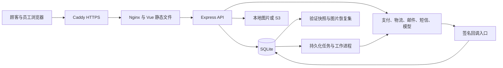

# 架构与运行边界

ShopMate-AI 面向单店、个人或小团队维护：Vue 前端、Express 单 API、SQLite 单写入节点。默认 `demo` 模式用于体验，`production` 模式在已实现供应商范围内接真实业务。目录及源码阅读顺序见[项目结构](project-structure.md)，配置见[生产指南](production.md)。

## 请求与数据流

公网仅发布生产入口 80/443。Nginx 只信任固定 Caddy 地址提供的客户端 IP，API 从受控代理取得真实 IP；内部监控接口在入口和 Nginx 均不公开。Caddy 镜像及配置的特定漏洞路径评估由[入口安全门禁](security/production-edge-vex.md)约束，修改镜像、配置或模块后需重新评估。

## 事务与异步边界

共享 TypeScript 类型在 `shared/domain/`。HTTP 入口校验身份、权限、来源、数据和请求标识，服务端业务方法检查当前库存、金额与业务状态。SQLite 同步事务落订单、库存、优惠券、积分和内部流水，外部网络请求在写事务外执行。全量 `/api/state` 已退出，页面使用按领域分页读取和投影。

支付单、退款单与商城订单分开保存；付款跳转、退款受理、物流签收都不能自行证明商城资金或售后操作已经完成。已验签通知先可靠入库再应答，由持久化任务与主动查询收敛渠道状态。同一有效支付单和商户单号的唯一性由数据库约束及业务检查共同保证。网络结果不确定时保留待核对状态；库存和优惠券在渠道确认关单后释放，退款确认成功后才入账。

业务变更与通知任务同事务产生，发送在事务外进行。任务有次数和时间边界，失败或未知状态保留记录和人工恢复入口；第三方投递不保证恰好一次。任务、支付、退款、外部通知的具体协议与恢复方式见[接口总览](api.md)和[外部服务接入](integrations.md)。

后台财务守恒核对、自动备份和 AI 文档处理使用独立工作进程，避免将重查询、快照复制或文档解析堆在 HTTP 主流程。它们共享单实例的受控 SQLite 存储，不构成多 API 高可用集群。AI 只生成需要顾客确认的业务提案；确认时重新检查权限和业务条件。

## 身份与隐私

顾客与员工使用服务端 Cookie 会话，生产使用 Secure Cookie、来源校验及独立请求头。生产注册须验证已配置的邮箱或手机号；旧账号浏览兼容，下单前补充验证。管理登录完成 TOTP 或恢复码校验后才获得完整后台会话。监控使用独立只读令牌，不依赖管理密码或绕过 MFA。

联系方式、验证码、MFA 密钥、恢复码及用户同意的协议版本独立持久化。敏感密钥加密或仅存摘要，验证码有限时、单次使用与发送校验额度。注销会检查未完成订单、售后及待核对资金，撤销会话并脱敏个人关联，保留必要的财务记录。详细入口见[认证说明](authentication.md)。

## 存储与恢复

当前业务版本为 5，存储版本为 1。历史缺失交易模式的流水解释为 `demo`，生产报表默认按真实模式统计；版本升级不重放历史库存与金额。旧二进制不能直接读取新版数据库，降级必须使用匹配的升级前恢复集并核对外部渠道资金变化。

图片元数据保存对象标识、原存储位置及摘要，切换当前配置不会自动迁移历史对象。知识库原文件继续存于 SQLite。可恢复备份包括验证过的数据库快照、清单及对应本地图片侧车；远端 S3 上传下载也需验证摘要。加密密钥单独保管，恢复加密数据时仍需要原密钥。操作与停机前提见[生产恢复](production.md#备份与失败恢复)。

## 部署取舍

生产发布先进入维护、验证升级前恢复集，再通过 SIGTERM 排空旧 API，启动目标镜像并迁移。解除维护前核对实际 API/Web 镜像 ID、提交标签、运行健康及生产模式；发布失败保持维护，恢复由维护者按已验证流程执行。

此架构不提供跨主机自动故障转移、数据库集群或零停机部署。同宿主目录副本只能证明副本一致性，真实异地容灾必须另行演练。容量数字只适用于对应报告记录的资源、数据、镜像和工作负载，见[验收记录](README.md#验收报告与证据)。
