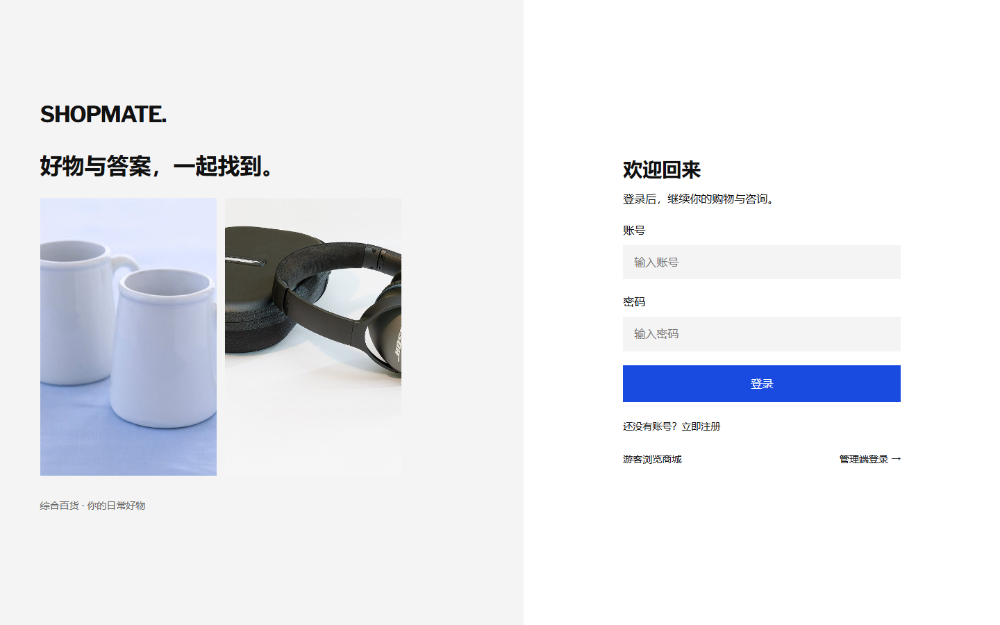
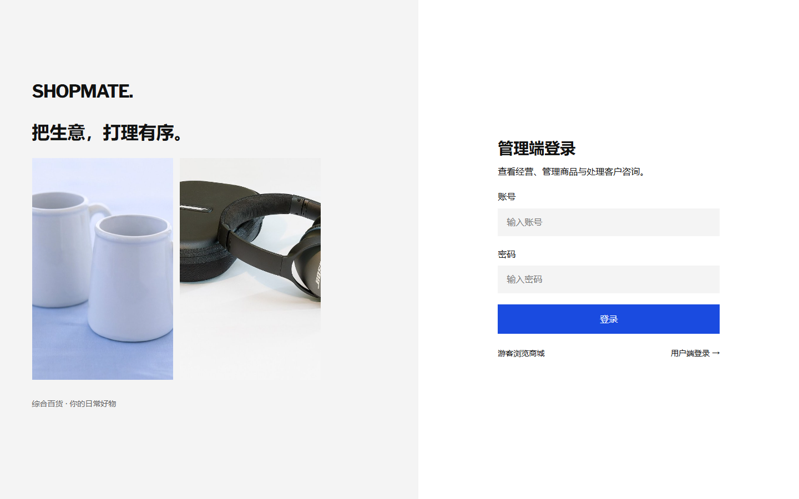
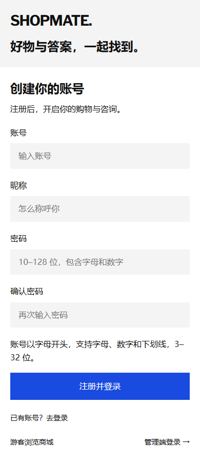

# 真实认证与部署验证

验证日期：2026-10-17（Asia/Shanghai）。本次将纯前端测试身份改为真实服务端账号与会话；支付、物流、退款和客服仍是业务模拟。

本页保留认证首版的实现及验证记录，后续已增加昵称维护、用户改密与员工权限。当前操作说明见 [开发与运维](development.md#账号维护)，当前权限与业务规则见 [业务接口](commerce-v4.md)，近期验证见 [角色验收](role-acceptance-20261020.md)；早期演进见 [传统电商归档](archive/traditional-commerce.md)。

## 实现范围

当前管理权限要求显式 `staff_access` 记录。首次创建管理员时与账号同事务写入店主权限；启动升级只对历史 UUID 管理员执行一次补录，既有 `staff-*` 员工不会自动升级。迁移标记写入后，权限记录缺失、无效或已停用均拒绝管理登录和会话，未映射的管理操作默认拒绝。缺失记录应由店主排查或执行明确维护，重启不会自动修复权限。

接口只接受普通 JSON 请求体，压缩请求返回415及 `UNSUPPORTED_CONTENT_ENCODING`；前端发送方式不变。

- 新增 Node.js / Express 后端，使用 Node 24 内置 SQLite。账号、会话、限流状态和业务数据持久化；业务操作在 SQLite 事务内提交，失败回滚。
- 用户可注册、自动登录、退出并重新登录。账号按小写唯一；昵称、账号格式和密码长度均在服务端校验。注册接口严格拒绝角色、用户 ID 等额外字段。
- 密码使用独立随机盐与 scrypt（N=131072、r=8、p=1、64 字节输出），使用定时安全比较。数据库不保存明文密码；不存在账号也执行密码派生，登录错误统一为「账号或密码错误」。
- 会话使用 32 字节随机令牌，数据库仅保存 SHA-256 摘要；Cookie 设置 HttpOnly、SameSite=Strict，支持 HTTPS Secure。用户与管理员 Cookie 独立，8 小时绝对有效期，登录替换当前角色旧令牌，退出即时撤销。
- 管理员仅通过环境变量首次初始化；不存在默认通用密码。提供管理员密码更新命令，更新后撤销该管理员的全部会话。
- 所有写入接口均要求自定义请求头和允许的 Origin，不开放 CORS。登录按来源连接限流，并按角色/账号限制尝试；注册同样限流，计数保存在 SQLite。
- 商品、库存、订单、售后和客服服务移到后端。接口固定所需角色，身份来自有效 Cookie，业务逻辑校验数据归属；响应只包含当前用户私有数据，管理数据仅返回给有效管理员。
- 前端路由每次进入时向服务端核验，后台轮询同步状态；会话失效后清理展示状态并回到登录页。网络请求有 10 秒超时，服务异常显示连接错误，不回退到演示身份。

旧 localStorage 业务数据和 sessionStorage 演示身份均不导入服务端，浏览器内容不能作为真实身份或业务事实。日常数据库保留初始商品，初始没有普通用户、订单和收货地址；固定 `lin` / `chen` 只存在于隔离测试夹具。

## 接口与持久化

| 接口 | 行为 |
| --- | --- |
| `POST /api/auth/register` | 注册普通用户并签发用户会话 |
| `POST /api/auth/login` | 按角色校验账号与密码，签发独立会话 |
| `POST /api/auth/profile` | 更新本人昵称并同步账号/业务资料 |
| `POST /api/auth/password` | 校验原密码、更新哈希并撤销该用户全部会话 |
| `POST /api/auth/logout` | 撤销指定角色当前会话并清除 Cookie |
| `GET /api/bootstrap?role=user` | 返回公共目录初始化和当前用户身份、有限私有上下文 |
| `GET /api/bootstrap?role=admin` | 按有效员工身份初始化管理上下文；业务列表另用分页接口 |
| `GET /api/state` | 固定 410，旧全量接口已退出 |
| `POST /api/actions/:method` | 允许列表、角色校验、参数校验、归属校验后执行操作 |
| `GET /api/health` | API 与 SQLite 连接健康检查 |

数据库包括 `accounts`、`sessions`、`rate_limits` 和 `state`。当前业务数据仍以单份 JSON 状态存于 `state`，SQLite `BEGIN IMMEDIATE` 保证读、校验、写入串行化；这是单实例实现，尚未宣称支持高并发集群。

Docker 后端仅开放内部 3001 端口，Nginx 对外监听本机 18086。数据卷为 `shopmate-ai_api_data`，挂载 `/app/data`；不得误删日常数据卷。前端构建不包含管理员密码，`.env` 和本地测试数据均被 Git 与 Docker 构建上下文忽略。

## 认证首版验证记录

| 验证 | 结果 |
| --- | --- |
| 后端 TypeScript | 通过 |
| 前端 vue-tsc / ESLint / 生产构建 | 通过 |
| 后端 HTTP 认证与业务测试 | 18 项通过 |
| 前端 HTTP 客户端单元测试 | 3 项通过 |
| 浏览器完整回归 | 15 项，覆盖登录注册和现有商品、库存、交易、售后、客服及页面适配 |
| 隔离 Docker 认证浏览器验收 | 4 项通过，实际经过 Nginx 与 API |
| 账号、会话持久化 | 隔离容器强制重建后，原账号与原有效 Cookie 均可继续使用 |
| 管理员密码更新 | 在隔离容器更新后，旧密码返回 401，新密码登录成功 |
| 官方 npm 源生产依赖审计 | 前后端均为 0 个已知漏洞 |
| 日常部署 | `web` 与 `api` 均健康，`/api/health` 返回 `ok` |
| 登录/注册视觉检查 | 已检查桌面登录、管理登录及 390px 注册页面截图 |

HTTP 用例验证了注册校验、账号重复与大小写唯一、密码哈希、Cookie 属性、错误密码、角色隔离、匿名拒绝、他人订单/地址访问拒绝、响应数据隔离、伪造身份拒绝、令牌轮换、退出撤销、过期拒绝、独立角色退出、来源检查、非法方法/JSON 拒绝、限流及数据库重开后持久化。

业务测试保留了金额快照、付款重验库存、并发不超卖、付款/退款幂等、退货门槛、库存审计、管理权限、数据归属和 FAQ/人工客服等行为检查；原浏览器存储损坏测试改为「篡改旧存储不会影响服务端认证」。

曾在 Windows Edge 全页导航中遇到一次 `ERR_SOCKET_NOT_CONNECTED`；单项复跑通过。Vite 开发模式下可出现 Element Plus 的 ResizeObserver 通知警告。生产构建保留已有后台包体积提示；这些不作为认证或交易成功证据。

共享类型、API 契约和商品种子位于独立 `shared/domain/`，后端测试和运行不依赖前端安装。首次远端 CI 暴露过共享源码放在 Vue 目录引入的配置耦合，已通过该目录调整修复。

首版 GitHub Actions 执行前后端验证、15 项完整浏览器回归及 4 项容器认证回归；当前流程已扩充传统电商回归。远端最终状态以对应提交的 Actions 结果为准。

## 已知范围

未实现邮箱/短信所有权校验、用户找回密码、多因素认证和完整风控。默认 HTTP 配置用于本机；公网部署需 HTTPS、Secure Cookie、实际 Origin、备份与运行监控。Nginx 未信任外部转发地址，当前按 API 连接来源进行的 IP 限流会由代理后用户共享；公网扩展前应配置可信代理和独立流量限制。

管理员恢复演示数据会重置所有用户的业务数据并保留账号，页面已明确提示；不提供公开删库接口。管理员密码维护命令仅在可访问部署环境的终端执行。

实现参考：[Node.js crypto](https://nodejs.org/docs/latest-v24.x/api/crypto.html)、[Node.js SQLite](https://nodejs.org/docs/latest-v24.x/api/sqlite.html)、[OWASP 会话管理](https://cheatsheetseries.owasp.org/cheatsheets/Session_Management_Cheat_Sheet.html)。

